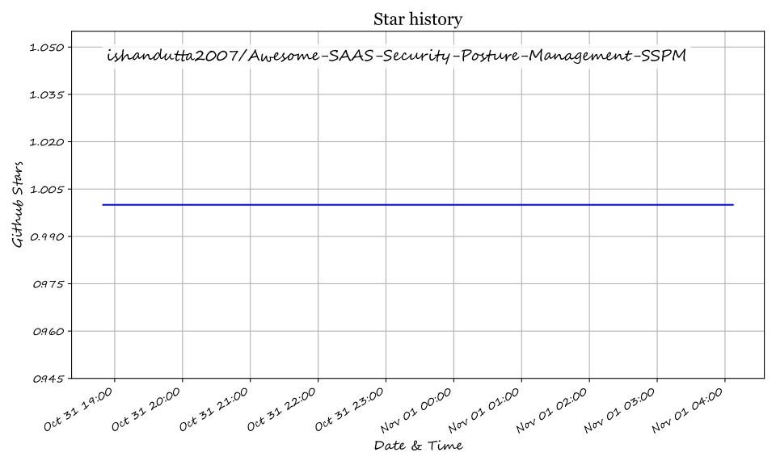

  

# 🛡️ Awesome SaaS Security Posture Management (SSPM)

  
  
  
  
  
  

> 🔍 A curated list of leading **SaaS Security Posture Management (SSPM)** platforms, tools, and open-source GitHub projects for SaaS configuration hardening, identity & access governance (ITDR), non-human identity (NHI) mapping, shadow SaaS discovery, and continuous compliance auditing.

---

## 📊 Sector Overview & Market Dynamics

The global **SaaS Security Posture Management (SSPM)** market size is valued at approximately **$480M–$500M** and is projected to expand rapidly toward **$3.5B+ by 2030**, recording an aggressive CAGR of ~48%. The sector is currently **moderately fragmented**—driven by agile, venture-backed pure-play innovators (Obsidian Security, AppOmni, Wing Security, Valence Security) addressing specialized risks such as third-party OAuth app permissions, AI agent governance, and SaaS misconfigurations—while steadily undergoing platform consolidation as cybersecurity conglomerates (CrowdStrike, Palo Alto Networks, Microsoft, Netskope) fold SSPM capabilities into unified CNAPP, CASB, and SASE security architectures.

---

## 📑 Table of Contents

- [☁️ SaaS / Hosted Platforms](#-saas--hosted-platforms)
- [💻 Open-Source GitHub Projects](#-open-source-github-projects)
- [🏗️ Evaluation & Architecture Guide](#️-evaluation--architecture-guide)
- [🤝 How to Contribute](#-how-to-contribute)
- [💖 Support](#-support)
- [⚠️ Disclaimer](#️-disclaimer)
- [📈 Star History](#-star-history)

---

## ☁️ SaaS / Hosted Platforms

Below is an overview of enterprise SaaS Security Posture Management platforms, comparing vendor market scale (market capitalization / valuation), starting tier pricing, and free tier or trial limits. Sorted by company scale in descending order:

| Platform | Company Scale (Valuation / Market Cap) | Starting Tier Pricing | Free Tier / Trial Limit | Key Focus & Strengths |
| :--- | :--- | :--- | :--- | :--- |
| **[Microsoft Defender for Cloud Apps](https://learn.microsoft.com/)** | **~$3.9 Trillion** *(Market Cap, MSFT)* | **$3.50 / user / month** *(standalone annual commit; bundled in M365 E5 / EMS E5)* | **30-Day Free Trial** *(up to 25 user licenses in M365 Security evaluation)* | Native M365 / Entra ID posture auditing, 90+ app risk indicators, CIS benchmark mapping, feeds directly into Microsoft Secure Score. |
| **[Palo Alto SaaS Security](https://www.paloaltonetworks.com/)** | **~$275 Billion** *(Market Cap, PANW)* | **~$175 / user / year** *(base Prisma Access / SaaS Security mobile user package)* | **30-Day Guided Proof-of-Concept (PoC)** *(includes 30-day VM-Series evaluation)* | Inline enforcement with NGFW integration, tenant-level granular blocking (e.g., Box downloads), unified SASE posture control. |
| **[CrowdStrike Falcon Shield](https://www.crowdstrike.com/)** | **~$110 Billion** *(Market Cap, CRWD)* | **£155 (~$195) / cloud user / year** *(G-Cloud framework benchmark, 50-user minimum)* | **15-Day Free Trial** *(Falcon SaaS Security / Cloud Security evaluation, no credit card required)* | Formed via Adaptive Shield acquisition; 3,500+ checks across 180+ SaaS apps, ITDR cross-correlation, device-to-SaaS identity risk mapping. |
| **[Netskope SSPM](https://www.netskope.com/)** | **~$8.8 Billion** *(IPO Valuation, NTSK)* | **~$50 / user / year** *(baseline Max Advantage bundle; enterprise SASE tiers ~$15–$30/user/mo)* | **Guided PoC / Evaluation** *(tenant test sandbox through sales/partner enablement)* | Graph-based correlation rules across SaaS apps, CASB/SASE integration, guided drift remediation, SIEM/SOAR/Snowflake pipelines. |
| **[Obsidian Security](https://www.obsidiansecurity.com/)** | **~$1.1 Billion** *(Series D Valuation)* | **~$4 / user / month** *(billed annually across organizational headcount)* | **30-Day Free SaaS & AI Risk Assessment** *(limited free tier available for third-party app auditing)* | Integration Risk Management (reduces third-party risk 80%), Obsidian Extend for niche & custom apps, compliance posture (SOC 2, NIST, ISO). |
| **[AppOmni](https://appomni.com/)** | **~$500 Million** *(Total Raised: $123M; Series C by Thoma Bravo)* | **$7,500 / year** *(starting baseline block of 100 users per SaaS application on AWS Marketplace)* | **Live Custom Product Demo** *(custom pilot evaluation upon technical qualification; no self-serve)* | Deep API posture management for core enterprise suites (Salesforce, Workday, M365, NetSuite); FedRAMP authorized. |
| **[DoControl](https://www.docontrol.io/)** | **~$150 Million** *(Total Raised: $45M; Acquired by Spin Systems)* | **$30,000 / year** *(annual mid-market contract for 500–1,500 users across 2–3 core apps)* | **30-Day Free SaaS Risk Exposure Assessment** *(available via AWS Marketplace $0 private offer)* | Configuration drift management across 200+ SaaS integrations, automated data access remediation playbooks, custom framework AI support. |
| **[Valence Security](https://www.valencesecurity.com/)** | **~$150 Million** *(Total Raised: $32M; Series A by M12 & YL Ventures)* | **$15,000 / year** *(annual baseline starter deployment across core SaaS/AI environments)* | **5-Day Guided SaaS Security Risk Assessment** *(agentless scan across M365, Google Workspace, and GitHub)* | SaaS and AI Security Posture Management (SSPM + AI-SPM), non-human identity (NHI) / OAuth integration discovery, ITDR playbooks. |
| **[Wing Security](https://wing.security/)** | **~$120 Million** *(Total Raised: $26M; Series A by GGV Capital)* | **$18 / user / year** *(starting paid tier for automated remediation & enterprise apps)* | **Forever Free Tier** *(unlimited SaaS discovery, SaaS Pulse health scoring, up to 100 app connections)* | Freemium discovery engine, SCuBA framework misconfiguration policies, bulk OAuth token revocation, shadow IT posture assessment. |

---

## 💻 Open-Source GitHub Projects

Open-source tooling in SSPM consists primarily of CLI posture evaluators, configuration baseline auditors, and access sync engines. 

The table below presents the top open-source projects sorted by GitHub Stars_Count in descending order. Each badge links directly to the repository's stargazers:

| Repository | GitHub_Stars | Focus & Description |
| :--- | :--- | :--- |
| **[turbot/steampipe](https://github.com/turbot/steampipe)** |  | Universal SQL query interface for APIs. Enables live SQL querying of SaaS security posture and configurations across Slack, GitHub, Google Workspace, Okta, and major clouds. |
| **[nccgroup/ScoutSuite](https://github.com/nccgroup/ScoutSuite)** |  | Multi-cloud and multi-tenant security auditing tool. *(Note: Unmaintained since May 2024; retained for historical context and auditing inspiration)*. |
| **[forter/security-101-for-saas-startups](https://github.com/forter/security-101-for-saas-startups)** |  | Comprehensive baseline checklists, architectural patterns, and hardening guides for securing modern SaaS companies and operations. |
| **[cisagov/ScubaGear](https://github.com/cisagov/ScubaGear)** |  | CISA's official assessment tool for Microsoft 365 security posture (SCuBA). Evaluates tenant configurations against CISA baselines via PowerShell and Open Policy Agent (OPA). |
| **[BishopFox/cloudfox](https://github.com/BishopFox/cloudfox)** |  | Automated situational awareness and attack path discovery tool for cloud and federated identity tenants. |
| **[cisagov/Sparrow](https://github.com/cisagov/Sparrow)** |  | CISA's forensic tool designed to detect compromised accounts, excessive OAuth permissions, and identity risks in Microsoft 365 and Azure AD. |
| **[silverhack/monkey365](https://github.com/silverhack/monkey365)** |  | Open-source PowerShell security assessment framework checking 300+ security configurations across Microsoft 365, Entra ID, and Azure subscriptions. |
| **[maester365/maester](https://github.com/maester365/maester)** |  | Automated PowerShell test framework powered by Pester for auditing Microsoft 365, Microsoft Graph, and Entra ID security configuration hygiene. |
| **[jonrau1/ElectricEye](https://github.com/jonrau1/ElectricEye)** |  | Multi-cloud and multi-SaaS posture management CLI in Python. Evaluates asset drift and misconfigurations mapped against 20+ compliance frameworks. |
| **[cisagov/ScubaGoggles](https://github.com/cisagov/ScubaGoggles)** |  | CISA's Secure Cloud Business Applications (SCuBA) automated configuration posture assessment tool specifically for Google Workspace. |
| **[open-sspm/open-sspm](https://github.com/open-sspm/open-sspm)** |  | Lightweight "who has access to what" identity auditor syncing Okta IdP identities with permissions in GitHub, Datadog, and AWS Identity Center. |
| **[PiotrMackowski/ClosedSSPM](https://github.com/PiotrMackowski/ClosedSSPM)** |  | Read-only SaaS posture management CLI in Go for enterprise platforms (starting with ServiceNow), exporting SARIF output for DefectDojo with MCP integration. |

---

## 🏗️ Evaluation & Architecture Guide

When designing or procuring a SaaS Security Posture Management solution, evaluate tools against the following key architectural capabilities:

1. **🌐 Breadth of Ecosystem Coverage:** Commercial platforms cover 150–200+ enterprise SaaS platforms (Salesforce, Workday, Google Workspace, GitHub, Slack, ServiceNow, M365), whereas open-source utilities specialize in single-ecosystem audits (e.g., CISA ScubaGear for M365, ScubaGoggles for Google Workspace).
2. **🔑 Non-Human Identity (NHI) & OAuth Governance:** Continuous discovery of shadow third-party integrations, OAuth tokens, and rogue AI extensions with automated revocation workflows.
3. **🚨 Identity Threat Detection & Response (ITDR):** Correlating user behavior (UEBA) and login activity against posture drift to catch active account takeovers.
4. **🔒 Configuration Hardening & Continuous Compliance:** Automated real-time scanning against CIS Benchmarks, NIST SP 800-53, ISO 27001, SOC 2, and SCuBA baselines.
5. **⚡ Automated vs. Guided Remediation:** API-driven rollback of unauthorized permission escalation, file exposure containment, and web-hook alert triggers into SIEM/SOAR pipelines.

---

## 🤝 How to Contribute

1. Fork this repository.
2. Add or update entries in `README.md`.
3. Ensure pricing, company metrics, and repository Stars_Badges adhere to the table structure.
4. Submit a pull request with a concise explanation.

---

## 💖 Support

Thank you for exploring and using this curated SaaS Security Posture Management guide! If you find this repository valuable:

- ⭐ **Star this repository** to show your appreciation and help others discover it.
- 🍴 **Fork and contribute** to expand the collective knowledge base.
- 📢 **Share with your network**, security peers, or cloud engineering teams.
- ☕ **Buy a coffee / support maintenance:** Visit the [GitHub Sponsors Dashboard](https://github.com/sponsors/ishandutta2007) to help support continuous updates and open-source curation!

---

## ⚠️ Disclaimer

- Community-curated resource for informational and architectural guidance; not an endorsement of specific vendors.
- SSPM tools access sensitive tenant configuration and metadata; ensure audit credentials utilize strictly scoped, read-only permissions (e.g., read-only ServiceNow roles, audit-only Graph scopes).
- Verify licensing and compliance guidelines for enterprise and commercial implementations.

---

##  Star History

## Star History

<a href="https://star-history.com/#ishandutta2007/Awesome-SAAS-Security-Posture-Management-SSPM&Timeline" align="center">
  <picture>
    <source media="(prefers-color-scheme: dark)" srcset="assets/ishandutta2007_Awesome-SAAS-Security-Posture-Management-SSPM_growth.svg">
    
  </picture>
</a>
